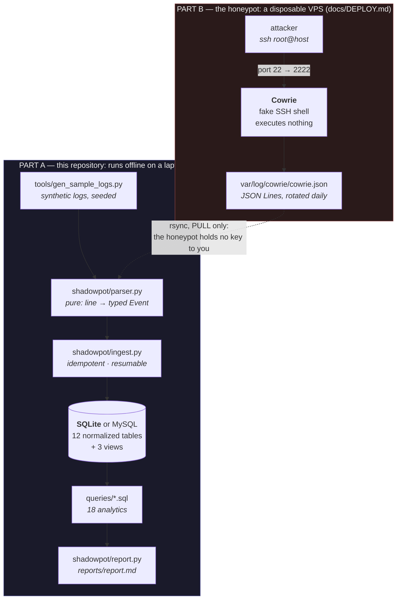

# ShadowPot

**An SSH honeypot pipeline: Cowrie logs → a normalized SQL schema → analytics on attacker behaviour.**

> **Status:** Part A — the analysis pipeline — is **complete and tested**: 364
> tests, a 12-table normalized schema in two SQL dialects, 18 analytics
> queries, an idempotent incremental loader, and a report generator.
> Part B — a real honeypot on the internet — **has not been deployed**, so this
> repository contains **no real attacker data and no real findings**.
> Everything you can run here operates on clearly-labelled synthetic logs.
> [`docs/DEPLOY.md`](docs/DEPLOY.md) is the runbook for the real thing, and
> [Limitations](#limitations-and-future-work) says exactly what is unmeasured.

A honeypot is a machine whose only purpose is to be attacked. Put a fake SSH
server on the public internet and within minutes something will try to log in;
within a day, thousands of things will. Each attempt is a small fact —
a username, a password, a source address, a timestamp — and a week of them is
a dataset about how automated attacks actually behave, as opposed to how
people assume they behave.

The honeypot itself is [Cowrie](https://github.com/cowrie/cowrie), which is
not rewritten here. **What this project builds is everything after the log
line**: a parser for Cowrie's JSON event stream, a normalized schema to put it
in, a loader safe to run from cron forever, and the SQL that turns a pile of
connection records into an answer to a question.

---

## Contents

| | |
|---|---|
| [Quick start](#quick-start) | run the whole thing in four commands |
| [Architecture](#architecture) | how the pieces fit |
| [What you actually get](#what-you-actually-get) | real output from the commands above |
| [The interesting parts](#the-interesting-parts) | the three problems worth reading about |
| [Measured results](#measured-results) | numbers, with their machine and their caveats |
| [Limitations](#limitations-and-future-work) | what this does not do |
| [Documentation](#documentation) | the five documents and what each is for |

---

## Quick start

Needs **Python 3.11+** and nothing else. No `pip install`, no server, no
Docker: the database is SQLite from the standard library, and the test suite
and report generator have no third-party dependencies.

```bash
git clone https://github.com/Kunal0626/shadowpot && cd shadowpot
```

```bash
make demo
```

That generates synthetic Cowrie logs, loads them, and writes
`reports/report.md`. It takes about four seconds. Then:

```bash
make test
```

```bash
make
```

`make` with no target lists everything. The four targets that matter are
`sample`, `load`, `report` and `test`; `make check` runs the suite *and* the
whole pipeline in a scratch directory, which is how the claim "a stranger can
clone this and reproduce it" is verified rather than asserted.

To point it at a real deployment's logs, give it a different database — never
the same one as synthetic data:

```bash
make load DB=data/real.db LOGS=~/shadowpot-real-logs && make report DB=data/real.db OUT=reports/real-report.md
```

---

## Architecture



The split matters. **Part A never touches the network and never runs on the
honeypot.** The honeypot's only job is to be attacked and write a log file;
every piece of analysis happens on a machine the attacker cannot reach. Logs
move by `rsync` initiated *from* the analysis machine, so the honeypot holds no
credential that leads anywhere — see [`docs/DEPLOY.md`](docs/DEPLOY.md) §9.

---

## What you actually get

Real output from the commands above, not an illustration.

**Loading.** The loader reports what it read, what it applied, and —
importantly — what it threw away and why:

```
  full    data/sample-logs/cowrie.json.2026-11-01.gz   (not seen before)
  full    data/sample-logs/cowrie.json.2026-11-02   (not seen before)
  ...
  files 7 scanned, 0 skipped
  lines 9253 read, 9087 applied, 0 already ingested
  skipped 43 malformed, 123 unknown events, 0 incomplete events

  why lines were skipped:
        47  unmodelled event cowrie.log.closed
        36  unmodelled event cowrie.session.params
        33  unmodelled event cowrie.client.size
        14  eventid is missing or not a string
        14  blank line
         7  invalid JSON: Unterminated string starting at
         7  top-level JSON is list, not an object
```

Run it again and it reads nothing: the files are unchanged, so every one is
skipped. Run it with `--force-rescan` and it reads all 9,253 lines again and
applies none of them. Both are tested.

**Querying.** Every query is a plain `.sql` file you can run by hand. This one
is the botnet signal — one credential pair arriving from many unrelated
addresses means those hosts share a list:

```
$ sqlite3 -header -column data/shadowpot.db < queries/15_shared_credentials.sql
username  password   distinct_ips  attempts  sessions
--------  ---------  ------------  --------  --------
root      123456     196           1625      597
root      root       123           643       362
root      admin      112           529       323
root      password   90            336       236
admin     admin      77            303       227
```

**The heuristic.** Command timing and sequence reuse, labelled as a heuristic
everywhere it appears because the log records what arrived, not who sent it:

```
verdict                                      sessions
-------------------------------------------  --------
scripted: commands faster than human typing  99
human-like                                   53
```

**The report.** `reports/report.md` opens with a banner when the data is
synthetic, then a plain-language summary assembled only from query results —
[see the committed sample](reports/sample-report.md):

> Across 7 days this honeypot recorded 670 sessions from 210 distinct
> addresses […] There were 5,332 login attempts, of which 152 succeeded. The
> most-tried credential pair was `root` / `123456`, attempted 1,625 times from
> 196 distinct addresses. The credential that was accepted was
> `root` / `123456`. **This is not evidence of a compromise:** a honeypot
> accepts whatever its configuration tells it to accept, so what this measures
> is which staged credential the attackers happened to find.

---

## The interesting parts

Three problems in this project were harder than they look. Each is written up
properly in the docs; this is the one-paragraph version.

### A nullable column silently broke uniqueness

The obvious schema is `credentials(username, password)` with
`UNIQUE(username, password)`. But Cowrie **omits `password` entirely** for
public-key login attempts, and **SQL treats NULLs as distinct inside a UNIQUE
constraint** — so that constraint does nothing for key-based attempts.
Measured: inserting `('root', NULL)` three times with `INSERT OR IGNORE`
yields three rows. Every re-ingest would have multiplied the key-based
credentials and inflated the "top credentials" table.

The fix is an **exclusive arc**: two dimension tables, both fully `NOT NULL`,
and `login_attempts` references exactly one, enforced by
`CHECK ((cred_id IS NULL) <> (keycred_id IS NULL))`. The empty-string sentinel
was rejected because `''` is itself one of the most-attempted passwords, so it
cannot double as "no password offered". → [`docs/NORMALIZATION.md`](docs/NORMALIZATION.md) §6.1

### `inode` + `size` + `offset` cannot detect every change to a log file

A resumable loader stores where it stopped. The standard trio — inode, size,
byte offset — handles rotation and truncation, and **misses a file truncated
in place and rewritten to the same length**: same inode, size equal to the
stored offset, so every check says "nothing new" while the entire contents
have been replaced. A test constructs exactly that, and it failed.
`ingest_state` therefore also stores the SHA-256 of the file's **first line**,
which never changes under append and always changes under rewrite. The
residual hole — a rewrite whose first line is byte-identical — is documented
rather than hidden. → [`shadowpot/ingest.py`](shadowpot/ingest.py)

### The report renders attacker-controlled strings

Usernames, passwords, commands and URLs come from whoever connected, and end
up in a Markdown table, a terminal, or a browser. A command containing a pipe
splits its table row into extra columns; an ANSI escape in a username is
interpreted by whatever `cat`s the file. A test feeding deliberately hostile
strings through the pipeline caught a live `ESC` character reaching the
report — the tables were escaped, the narrative was not. Escaping also has to
*preserve* the evidence: the report shows `\x1b`, because the fact that an
escape was sent is itself a finding. → [`shadowpot/report.py`](shadowpot/report.py)

---

## Measured results

**Every number here was produced by `python3 tools/measure.py` and is
regenerated into [`docs/MEASUREMENTS.md`](docs/MEASUREMENTS.md).** Nothing in
this section was typed in by hand.

Measured on: macOS 26.6.2, arm64 (Apple Silicon) · Python 3.14.6 ·
SQLite 3.50.4 via Python, 3.51.0 CLI · MySQL client 9.5.0 · GNU Make 3.81.

| | 7 days (synthetic) | 30 days (synthetic) |
|---|---:|---:|
| Log files on disk | 2.7 MB | 53.8 MB |
| Lines read | 9,253 | 160,708 |
| Sessions / attempts / commands | 670 / 5,332 / 942 | 11,318 / 95,086 / 16,026 |
| Database size | 3.4 MB | 57.3 MB |
| **Load** | **under 1 s** | **under 10 s** |
| Run all 18 queries | ~20 ms | ~450 ms |
| Build the report | ~0.1 s | ~0.5 s |

Those loads are quoted as **conservative bounds**, not point estimates, and
that is deliberate. Repeated measurements of the same 30-day load have ranged
from 6.0 s to 8.8 s depending on what else the laptop was doing — a spread of
40%. Quoting "26,780 lines/s" would read as precision it does not have and
collapse the moment anyone re-ran it; "under 10 seconds for 160,708 lines" has
held across every run so far.

The live figures, including the fastest and slowest of each batch, are in
[`docs/MEASUREMENTS.md`](docs/MEASUREMENTS.md). A test asserts the bound above
is never *smaller* than the measured one, so this table cannot quietly become
optimistic.

| | |
|---|---:|
| Tests (all passing, 1 skipped) | **364** |
| Test suite wall clock | ~1.4 s |
| Normalized tables / views / analytics queries | 12 / 3 / 18 |
| Candidate indexes measured / kept | 7 / 4 |

Source size is in [`docs/MEASUREMENTS.md`](docs/MEASUREMENTS.md) rather than
here, for a dull but real reason: that count includes this file, so a README
quoting it could never settle — editing the number changes the number.

**These are throughput figures on generated data, on one laptop.** They say
how fast this code processes synthetic logs. They are not findings about
attackers, and the numbers that *would* be are in the next section, marked
as unmeasured.

Index tuning is measured separately, with each candidate created alone from an
unindexed baseline: [`docs/INDEXES.md`](docs/INDEXES.md), regenerated by
`make bench`. Four of seven candidates earned a place. The one predicted to be
redundant — `login_attempts(session_pk)`, already covered by
`UNIQUE(session_pk, ts)` — turned out to be used by more queries than any
other, because it is a third of the width and reads far fewer pages.

---

## Limitations and future work

Stated plainly, because a project that claims less than it does is worth more
than one that claims more.

**No real deployment yet.** This is the big one. Days deployed, sessions
captured, unique source addresses, real top credentials and malware samples
are all **not measured**. They require a honeypot on the public internet,
which is [`docs/DEPLOY.md`](docs/DEPLOY.md), and they are the only numbers
that may ever appear on a resume.

**The bot-versus-human split is a heuristic, and its thresholds are
unvalidated.** The synthetic populations separate cleanly — 19–83 ms against
5.2–10.7 s — which demonstrates the SQL is correct and proves nothing about
whether 250 ms suits real traffic, since the generator was written with that
separation in mind and cannot disconfirm it.

**The MySQL path has never run against a live server.** It is wired end to
end and its generated SQL is asserted for both dialects, but the round trip is
unverified: the development machine's MySQL needs a password this project does
not store. A test asserts the module keeps saying so.

**No geolocation or ASN.** Deliberate. It needs an offline GeoIP database this
project does not ship, and ShadowPot makes **no** live lookups against
attacker addresses — no API, no reverse DNS, no reputation service.

**Not in 1NF, in one documented place.** The key-exchange algorithm lists are
stored as delimited strings rather than a child table, because no query filters
by an individual algorithm. The remedy is named in
[`docs/NORMALIZATION.md`](docs/NORMALIZATION.md) §3.

**Single sensor.** `UNIQUE(sensor_id, cowrie_session_id)` is correct for many
sensors, but `artifacts.outfile` depends on one deployment's `download_path`,
so merging two differently-configured honeypots would break that dependency.

**Known smaller gaps.** The `ingested_lines` ledger grows by one row per log
line and is never pruned. `commands.seq` is computed by a window function
rather than stored; whether that needs materializing is a measurement not yet
taken at real-world scale. Telnet events are parsed but no analytics use them.

---

## Documentation

| Document | What it is for |
|---|---|
| [`docs/LOG_FORMAT.md`](docs/LOG_FORMAT.md) | The exact Cowrie JSON fields, read from Cowrie's source at a pinned version rather than from its website, which was three releases stale. Includes the three findings that contradicted this project's own original plan. |
| [`docs/NORMALIZATION.md`](docs/NORMALIZATION.md) | Flat log → functional dependencies → 1NF → 2NF → 3NF, with the ER diagram, and a section on the three decisions normal forms cannot make for you. |
| [`docs/INDEXES.md`](docs/INDEXES.md) | Generated. Every index with the measurement that justified it, and every rejected candidate with the measurement that rejected it. |
| [`docs/MEASUREMENTS.md`](docs/MEASUREMENTS.md) | Generated. Every number in this README, plus an explicit list of what is not measured. |
| [`docs/DEPLOY.md`](docs/DEPLOY.md) | The Part B runbook: VPS, firewall, moving the real `sshd`, Cowrie install verified against 3.1.5, log retrieval, a 7-day checklist, teardown, and the ethics. |
| [`docs/INTERVIEW_NOTES.md`](docs/INTERVIEW_NOTES.md) | Every design decision with the alternatives considered, and the fifteen hardest questions this project invites, answered. |
| [`docs/RESUME_BULLETS.md`](docs/RESUME_BULLETS.md) | Candidate bullets split by whether the evidence exists today, each traced to the command that produced its numbers — plus the bullets *not* to write, and why each fails. |

---

## Repository layout

```
shadowpot/           parser.py  db.py  ingest.py  analytics.py  report.py
schema/              schema.{sqlite,mysql}.sql   indexes.{sqlite,mysql}.sql
queries/             00..17 *.sql, plus mysql/ overrides where dialects differ
tools/               gen_sample_logs.py  bench_indexes.py  measure.py  clean.py
tests/               364 tests, standard-library unittest only
docs/                the six documents above
reports/             sample-report.md (committed); report.md is generated
data/                generated logs and databases (gitignored)
```

Generated logs and databases are **not committed**. The generator and the
expected-result tests are the committed proof, so a clean clone reproduces the
data exactly rather than downloading it. Raw Cowrie logs are gitignored for a
second reason: they are an unaggregated record of third parties' activity, and
this project publishes aggregates.

## Testing

```bash
make test
```

364 tests, standard library only, run with `-W error::ResourceWarning` so a
leaked database handle fails the suite instead of printing a warning nobody
reads. Several tests assert that a *rejected* design is broken — that NULLs
defeat `UNIQUE`, that foreign keys are off by default in SQLite — so the
reasoning behind the real design cannot quietly be lost.

## License

[MIT](LICENSE).

Cowrie itself is a separate project under BSD-3-Clause and is not vendored
here.

---

Part of my portfolio: [github.com/Kunal0626](https://github.com/Kunal0626)
