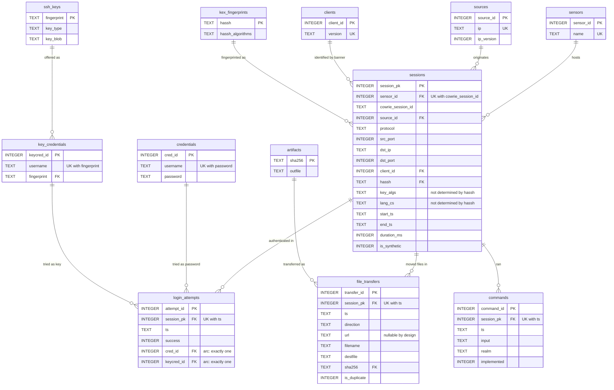

# Normalization: from a flat log to the ShadowPot schema

This document does the work the schema files only summarize. It starts from the
denormalized table you would get by loading `cowrie.json` verbatim, lists its
functional dependencies, and walks 1NF -> 2NF -> 3NF to arrive at
`schema/schema.sqlite.sql`.

It also records three places where normal forms alone do **not** give the right
answer, and one place where ShadowPot knowingly departs from strict 1NF. Those
sections matter more than the textbook walk, because they are where real
schemas are actually decided.

Field-level provenance for every Cowrie field named here is in
[LOG_FORMAT.md](LOG_FORMAT.md).

---

## 0. Where the measurements in this document come from

Every claim below marked *measured* was produced on this machine and is
re-runnable with `python3 -m unittest discover -s tests -t .`

| | |
|---|---|
| Machine | Apple Silicon, arm64 (T8122), Darwin 25.6.0 (macOS) |
| Python | 3.14.6 |
| SQLite via Python stdlib | **3.50.4** |
| SQLite CLI (`sqlite3`) | **3.51.0** |
| MySQL | 9.5.0, installed but **schema not applied** (see §9) |
| Tests | 41 tests, 40 passing, 1 skipped (the MySQL one) |

Note the two different SQLite versions. The `sqlite3` command-line tool and the
version Python's `sqlite3` module links against are **different builds on the
same machine**. Anything measured through one is not automatically true of the
other, so the tests measure through Python, which is what the loader uses.

---

## 1. The starting point: one flat table

Load every JSON line into one relation, one row per line, one column per field
that any event can carry. This is the honest "just put the log in a table"
design, and it is what a lot of log pipelines actually ship.

```sql
CREATE TABLE flat_log (
    line_sha256       TEXT PRIMARY KEY,  -- hash of the raw line
    -- shared attributes
    sensor            TEXT, session      TEXT, timestamp TEXT,
    eventid           TEXT, message      TEXT, late      INTEGER,
    -- connection attributes
    protocol          TEXT, src_ip       TEXT, src_port  INTEGER,
    dst_ip            TEXT, dst_port     INTEGER,
    -- authentication
    username          TEXT, password     TEXT,
    fingerprint       TEXT, key_blob     TEXT, key_type  TEXT,
    -- client identity
    client_version    TEXT, hassh        TEXT, hassh_algorithms TEXT,
    kex_algs          TEXT, key_algs     TEXT, enc_cs    TEXT,
    mac_cs            TEXT, comp_cs      TEXT, lang_cs   TEXT,
    -- shell
    input             TEXT, realm        TEXT,
    -- files
    url               TEXT, outfile      TEXT, shasum    TEXT,
    destfile          TEXT, filename     TEXT, duplicate INTEGER,
    -- session end
    duration_ms       INTEGER
);
```

Three things are already visible without any theory:

- **It is overwhelmingly NULL.** A `cowrie.command.input` row populates 8 of 30
  columns. The table is a union of unrelated record types wearing one costume.
- **Every column is nullable, so nothing can be constrained.** You cannot say
  "a login attempt must have a username" without also forbidding command rows.
- **The strings repeat enormously.** One botnet hammering `root/123456` from
  one client stores those three strings once per attempt, forever.

---

## 2. Functional dependencies

A functional dependency `X -> Y` means: fix X, and Y is determined. These are
the dependencies that actually hold in Cowrie data, with the reason each one
holds.

| | FD | Why it holds |
|---|---|---|
| **F1** | `line_sha256 -> {all}` | A hash of the whole line determines the line. Trivially a key. |
| **F2** | `(sensor, session, timestamp) -> {all}` | A second candidate key. One event per session per instant. Rests on the assumption in §6.3. |
| **F3** | `(sensor, session) -> protocol, src_ip, src_port, dst_ip, dst_port, client_version, hassh, key_algs, lang_cs, duration_ms` | These describe the **connection**, not the event. Every event in a session repeats them. |
| **F4** | `hassh -> hassh_algorithms` | HASSH *is* the MD5 of `hassh_algorithms`. The digest determines its own input (barring MD5 collisions). |
| **F5** | `hassh -> kex_algs, enc_cs, mac_cs, comp_cs` | Those four lists are exactly the semicolon-separated components of `hassh_algorithms`, so F4 implies this. |
| **F6** | `fingerprint -> key_blob, key_type` | A fingerprint is a hash of the key. |
| **F7** | `shasum -> outfile` | Cowrie stores a captured file at a path **named after its checksum**. Holds within one deployment; see §8.2. |
| **F8** | `sensor -> {}` and `src_ip -> {}` | These are bare identities with no dependent attributes of their own. They become lookup tables for reasons other than normalization (§7). |

And two FDs that look true but are **not**, which is where this gets interesting:

| | Non-FD | Why not |
|---|---|---|
| **N1** | `hassh -/-> key_algs, lang_cs` | `server_host_key_algorithms` and `languages` are **not inputs to the HASSH digest**. Two clients with identical HASSH can offer different host-key algorithms. These belong to the session, not the fingerprint. |
| **N2** | `session -/-> sensor` | Cowrie generates session ids as `uuid.uuid4().hex[:12]` **per process**. Two sensors can mint the same id independently, so `session` alone identifies nothing globally. This is why `sensor` appears in F2 and F3. |

N1 is the trap. All eight kex fields arrive in one event, so they look like one
unit. Four of them are determined by the fingerprint and two are not.

---

## 3. First normal form

**Requirement:** every attribute holds a single atomic value; no repeating
groups.

**Violation.** `kex_algs`, `key_algs`, `enc_cs`, `mac_cs`, `comp_cs` and
`lang_cs` arrive from Cowrie as **JSON lists** and would be stored as delimited
strings. `"curve25519-sha256,ecdh-sha2-nistp256,diffie-hellman-group14-sha1"`
is a repeating group in a single cell. It cannot be joined on, indexed usefully,
or filtered by one element without `LIKE '%...%'`.

**The strictly correct fix** is a child table:

```sql
CREATE TABLE session_algorithms (
    session_pk  INTEGER REFERENCES sessions(session_pk),
    category    TEXT,     -- 'kex' | 'key' | 'enc_cs' | 'mac_cs' | ...
    position    INTEGER,  -- preference order matters in SSH
    algorithm   TEXT,
    PRIMARY KEY (session_pk, category, position)
);
```

**What ShadowPot actually does, and why.** It keeps `hassh_algorithms`,
`key_algs` and `lang_cs` as single opaque strings and does **not** build
`session_algorithms`. That is a deliberate 1NF compromise, and it is stated
rather than hidden:

- Not one of the analytics in Phase 5 filters or groups by an individual
  algorithm. They use `hassh` as an **identity** -- "which client fingerprints
  attack us" -- and the identity of the joined string is precisely what HASSH
  means.
- The child table would add one table and roughly 40 rows per session to
  support no query that exists.
- The cost is bounded and the remedy is known: if a query ever needs
  per-algorithm analysis ("which attackers still offer
  `diffie-hellman-group1-sha1`"), `session_algorithms` is populated by splitting
  `hassh_algorithms` on `;` and then on `,`. No data is lost by waiting, because
  the full string is retained.

This is the one place ShadowPot is not in 1NF. Claiming otherwise would be
easier and false.

Everything else is already atomic: timestamps, ports, usernames, passwords and
command lines are single values. A command line like `cd /tmp && wget x` is
atomic *as a command line*; it is the unit Cowrie observed and the unit an
analyst reasons about.

---

## 4. Second normal form

**Requirement:** 1NF, plus no non-key attribute depends on only *part* of a
composite candidate key.

Take the candidate key `(sensor, session, timestamp)` from **F2**. Then **F3**
is a textbook partial dependency: `(sensor, session)` is a proper subset of that
key, and it determines ten attributes.

**The anomalies this causes**, concretely:

- **Insertion.** You cannot record that a connection happened until it has
  produced an event with a timestamp. A connection is not an event.
- **Update.** Correcting one mis-parsed `client_version` means rewriting every
  row of that session.
- **Deletion.** Delete a session's only remaining event row and the fact that
  the connection ever existed disappears with it -- including its source IP and
  duration.
- **Inconsistency.** Nothing stops two rows of one session carrying different
  `src_ip` values. The database cannot tell you which is right.

**The decomposition.** Split the connection attributes into their own relation,
keyed on what determines them:

```
sessions(sensor, session, protocol, src_ip, src_port, dst_ip, dst_port,
         client_version, hassh, key_algs, lang_cs, start_ts, end_ts,
         duration_ms)

events(sensor, session, timestamp, eventid, ...event-specific fields...)
```

`sessions` is where `start_ts`, `end_ts` and `duration_ms` land, and note that
`duration_ms` could only ever have lived here: it arrives on exactly one event
(`cowrie.session.closed`) but describes the whole connection.

At this point the remaining `events` relation is still a mostly-NULL union of
record types, so it is split by event kind into `login_attempts`, `commands` and
`file_transfers`. That split is not demanded by 2NF -- it is demanded by the
ability to declare constraints. Once `commands` is its own table, `input` can be
`NOT NULL`; in the flat table it could not be.

---

## 5. Third normal form

**Requirement:** 2NF, plus no non-key attribute is determined by another
non-key attribute (no transitive dependencies).

Three transitive dependencies survive into the 2NF design.

### 5.1 `hassh -> hassh_algorithms` (F4)

In `sessions`, the key is `(sensor, session)`. Both `hassh` and
`hassh_algorithms` are non-key attributes, and the first determines the second:

```
(sensor, session) -> hassh -> hassh_algorithms
```

A transitive dependency, so a 3NF violation. The redundancy is real and large:
10,000 sessions from one botnet store one ~120-character algorithm string
10,000 times, and it is derivable from a 32-character digest already present.

**Decomposition:** `kex_fingerprints(hassh PRIMARY KEY, hassh_algorithms)`,
with `sessions.hassh` as a foreign key.

**And the trap from N1:** `key_algs` and `lang_cs` must stay on `sessions`. They
are not inputs to the digest, so `hassh` does not determine them. Moving all
eight fields into `kex_fingerprints` -- the obvious, symmetrical-looking choice
-- would assert a dependency that does not hold, and would silently collapse
genuinely different sessions onto one fingerprint's values.

Note also what a `clients(client_id, version, hassh)` table would have done:
`hassh_algorithms` would then depend on `hassh`, which is only *part* of that
key -- a **2NF** violation, which is worse. Splitting `clients` (banner string)
and `kex_fingerprints` (digest) apart avoids both.

### 5.2 `fingerprint -> key_blob, key_type` (F6)

Same shape. A public-key attempt is identified by `(username, fingerprint)`, and
`key_type` and `key_blob` depend on `fingerprint` alone -- part of that key, so
this one is a 2NF violation if `(username, fingerprint)` is the key, and a 3NF
violation if a surrogate key is used. Either way it decomposes:

```
ssh_keys(fingerprint PRIMARY KEY, key_type, key_blob)
key_credentials(keycred_id, username, fingerprint -> ssh_keys, UNIQUE(username, fingerprint))
```

This matters practically because `key_blob` is a multi-kilobyte base64 string.
One bot trying one key against 500 usernames stores it once, not 500 times.

### 5.3 `shasum -> outfile` (F7)

Cowrie names a captured file after its checksum, so the storage path is
determined by the hash:

```
file_transfers(..., shasum, outfile)   -- outfile transitively dependent
```

**Decomposition:** `artifacts(sha256 PRIMARY KEY, outfile)`, with
`file_transfers.sha256` as a foreign key. One malware sample fetched by 300 IPs
is one `artifacts` row and 300 transfer rows.

---

## 6. Where normal forms stop helping

Three decisions in this schema are not derivable from 1NF/2NF/3NF at all. They
are the ones most likely to be asked about, because they are where the thinking
is.

### 6.1 NULL defeats UNIQUE, and 3NF has nothing to say about it

The brief's design is `credentials(cred_id, username, password,
UNIQUE(username, password))`. It is in 3NF. It is also broken, because Cowrie
**omits `password` entirely** for public-key attempts, and SQL treats NULLs as
*distinct* inside a UNIQUE constraint.

*Measured* (`tests/test_schema.py::test_counterfactual_nullable_password_does_not_deduplicate`):
inserting `('root', NULL)` three times with `INSERT OR IGNORE` into a table with
`UNIQUE(username, password)` yields **3 rows**. The constraint does nothing. So
re-ingesting one day of logs would multiply every key-based credential, and the
"top credentials" table would be inflated by exactly the traffic that has no
password at all.

Three candidate fixes:

| Fix | Why rejected / chosen |
|---|---|
| Nullable `password` | **Rejected.** Silently fails to deduplicate, as measured. The failure is invisible until the counts are already wrong. |
| Sentinel `''` for "no password" | **Rejected.** The empty password is itself one of the most-attempted passwords in real brute-force traffic. The sentinel would be ambiguous between "no password offered" and "empty password offered" -- two genuinely different events. A test asserts `('root', '')` is storable as real data. |
| **Exclusive arc** | **Chosen.** Two dimension tables, both fully `NOT NULL`, and `login_attempts` references exactly one: `CHECK ((cred_id IS NULL) <> (keycred_id IS NULL))`. |

The arc keeps both sides' UNIQUE constraints working on `NOT NULL` columns,
keeps the meaning of every row exact, and is enforced by the database rather
than by the loader. `v_login_attempts` flattens it back into one readable shape
so queries do not pay for the structure.

*Measured:* three public-key attempts with the same username and fingerprint
collapse to **1** `key_credentials` row.

### 6.2 Derived data is not a normal-form question, and it is still wrong

The brief has `sources(ip, first_seen, last_seen)`. Those columns are in 3NF --
they depend fully on the key. They are also aggregates over `sessions`, which
means the database would hold two copies of one truth and the loader would have
to keep them agreeing forever. Every incremental load would have to remember to
update them; one missed path and they drift, silently, with no constraint able
to notice.

ShadowPot stores neither and computes both in `v_source_activity`. The same
reasoning removed the `commands.seq` column the brief suggests: nothing in the
Cowrie event carries a sequence number, so `seq` would be data ShadowPot
derives. `v_session_commands` supplies it with
`ROW_NUMBER() OVER (PARTITION BY session_pk ORDER BY ts, command_id)`.

**The trade-off is real and is not yet resolved.** "Most common first command"
is an index seek against a stored `seq` and a windowed scan against the view.
Phase 5 measures it with `EXPLAIN QUERY PLAN`; if the window function is too
slow at the sizes actually reached, `seq` gets materialized **and the
measurement that justified it goes in `docs/INDEXES.md`**. Denormalizing on
evidence is engineering; denormalizing on a hunch is how schemas rot.

### 6.3 One assumption, stated rather than buried

Every fact table's natural key is `UNIQUE (session_pk, ts)`. That rests on:
*no two events in one session share a microsecond.*

It is a good assumption -- Cowrie timestamps carry microsecond precision and
each event costs a write plus an `fsync`-less flush -- but it is an assumption,
not a guarantee. So `ingested_lines` exists as a second, assumption-free layer:
the SHA-256 of every raw line already applied. It costs one row per log line
(~100 bytes; ~10 MB for a 100k-event week) and it is the only mechanism that
does not depend on timestamps being unique.

Both layers are tested. Belt and braces, with the cost written down.

---

## 7. Why `credentials` is its own table

This is the question the brief asks, and the usual answer is wrong, so it is
worth being precise.

**The weak answer:** "it removes an update anomaly." Inline `username` and
`password` on `login_attempts` would not actually create a classic update
anomaly, because you never *rename* a credential. Each attempt genuinely used
that pair, so 50,000 attempts at `root/123456` are 50,000 distinct facts, not
one fact stored 50,000 times.

**The real reasons**, in order of weight:

1. **It is what makes idempotent ingestion possible.** `UNIQUE(username,
   password)` plus `INSERT OR IGNORE` is how re-running the loader on the same
   file does not duplicate credentials. Without the table there is no place to
   put that constraint. *Measured:* three inserts of `root/123456` yield 1 row.
2. **Storage grows with distinct pairs, not attempts.** Credential dictionaries
   are small and reused endlessly; the attempt count is large. This is the
   difference between storing a dictionary once and storing it once per guess.
3. **A credential gets a stable identity.** "Credentials tried from more than
   20 distinct IPs" -- the botnet signal -- becomes a join and a
   `GROUP BY cred_id HAVING COUNT(DISTINCT source_id) > 20` over integers,
   rather than a `GROUP BY` over millions of string pairs.
4. **There is one genuine update anomaly, and it is specific to log
   processing: repair.** If the parser is found to have mangled an encoding, the
   correction touches one row per distinct pair rather than one per attempt.
   Re-processing is a normal event in a log pipeline, which makes this less
   hypothetical than it sounds.

A related point worth making in the same breath: **case sensitivity**. `root`,
`Root` and `ROOT` are three different guesses. SQLite compares bytes by default;
MySQL's default collation does not. See §9.

---

## 8. The resulting schema

### 8.1 ER diagram



Three operational tables are omitted from the diagram because they hold
pipeline bookkeeping rather than attacker data and have no relationships:
`db_meta`, `ingested_lines`, `ingest_state`, `ingest_runs`.

### 8.2 How to read it in one sentence each

| Group | Tables | What they are |
|---|---|---|
| Dimensions | `sensors`, `sources`, `clients`, `kex_fingerprints`, `credentials`, `ssh_keys`, `key_credentials`, `artifacts` | Things that repeat across many events; each has a UNIQUE natural key on NOT NULL columns, so `INSERT OR IGNORE` is a safe no-op. |
| Hub | `sessions` | One row per connection. Filled in by several events over the session's life, so the loader UPSERTs it. |
| Facts | `login_attempts`, `commands`, `file_transfers` | One row per logged event, each keyed `(session_pk, ts)`. |
| Operational | `db_meta`, `ingested_lines`, `ingest_state`, `ingest_runs` | Resumability, idempotence and an audit trail. Not attacker data. |

### 8.3 Scope assumptions written down, not discovered later

- **Single sensor.** `UNIQUE(sensor_id, cowrie_session_id)` is correct for many
  sensors, but `artifacts.outfile` (F7) depends on one `download_path` setting.
  Merging two sensors configured differently breaks F7.
- **Loose session-id CHECK.** Hex, 8-64 characters, rather than `length = 12`.
  Older Cowrie used a different width and uppercase hex, and this schema must
  load archived logs. Cowrie's own `docs/sql/mysql.sql` still declares
  `char(32)`, which its code has not produced for years -- a constraint that
  outlived its fact.
- **`message` is discarded.** It is human-readable text derived from the other
  fields. Nothing queries it.

---

## 9. The two dialects

| Concern | SQLite (canonical) | MySQL |
|---|---|---|
| Timestamps | `TEXT`, one canonical form `YYYY-MM-DDTHH:MM:SS.ffffffZ`, enforced by `CHECK ... GLOB`. ISO-8601 in this form sorts lexicographically in chronological order. | `DATETIME(6)`. The type enforces what the CHECK did; 8 bytes instead of 27. |
| Date bucketing | `substr(ts, 1, 10)` | `DATE(ts)` -- the main reason `queries/mysql/` overrides exist |
| Type discipline | `STRICT` tables | native typing |
| Collation | byte-exact by default | **must pin `utf8mb4_bin`** |
| Indexed text | unbounded `TEXT` | bounded `VARCHAR`; InnoDB caps an index key at 3072 bytes |
| Foreign keys | `PRAGMA foreign_keys = ON` **per connection** | InnoDB enforces by default |

Two of those deserve more than a table row.

**Collation changes results, not just syntax.** MySQL's default
(`utf8mb4_0900_ai_ci`) is case- and accent-insensitive. Under it,
`UNIQUE(username, password)` folds `root`, `Root` and `ROOT` into **one**
credential, and `COUNT(DISTINCT username)` disagrees between the two engines on
identical input. Attacker-supplied strings are bytes, not prose. Every table in
`schema.mysql.sql` is therefore declared `COLLATE=utf8mb4_bin`, and a test
asserts that none of them lost it.

**Bounded VARCHAR introduces a limitation SQLite does not have.** Columns inside
a UNIQUE key must be `VARCHAR`, and utf8mb4 costs 4 bytes per character, so
`credentials` uses `VARCHAR(255)` twice (2040 bytes, under the 3072 cap). An
attacker can send a longer username. MySQL's default `sql_mode` includes
`STRICT_TRANS_TABLES`, so such a row is **rejected with an error** rather than
truncated -- the right behaviour, but the loader has to catch it and count it as
`ingest_runs.events_incomplete`.

**Verification status, stated plainly.** The SQLite schema is applied and
exercised by 40 passing tests on every run. The MySQL schema has **not been
applied to a live server**: MySQL 9.5.0 is installed on this machine but
rejects connections without credentials, and this project does not store
database passwords. Offline tests assert the two files declare the same tables,
the same views, and a binary collation on every table -- which catches drift but
is not the same as applying it. To close that gap:

```bash
mysql -u <user> -p -e "CREATE DATABASE shadowpot_test"
mysql -u <user> -p shadowpot_test < schema/schema.mysql.sql
```

The one construct most likely to need adjusting is `REGEXP_LIKE` inside a
`CHECK` (used for hex validation); CHECK constraints are only enforced from
MySQL 8.0.16 onward.

---

## 10. Interview questions this document answers

1. **Why is `credentials` its own table, and what anomaly does that remove?**
   §7. The honest answer names idempotent ingestion first and resists claiming
   a classic update anomaly that is not really there.
2. **Your `UNIQUE(username, password)` has a nullable password. What happens?**
   §6.1, with a measured counterfactual.
3. **All eight key-exchange fields arrive in one event. Which belong together?**
   §5.1 and N1. Four are determined by the fingerprint; two are not.
4. **Which of your columns are derived, and why don't you store them?**
   §6.2 -- `first_seen`, `last_seen`, `seq` -- plus the conditions under which
   the decision gets reversed on evidence.
5. **Is your schema in 1NF?** §3. No, in one specific, documented place, with
   the exact remedy named.
6. **Your session primary key is a 12-character hex id. What is wrong with
   that?** N2 and §8.3. It is unique per process, not globally, and 48 bits of
   entropy is not infinite.
7. **Would the same queries give the same answers on MySQL?** §9. Not without
   pinning the collation.
